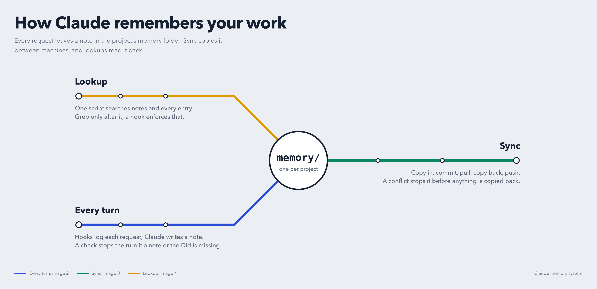

# Project memory for Claude Code

This gives Claude Code a long-term notebook for each of your projects: one install, any number of projects, each with its own `memory/` folder. Claude writes the notes as part of the work, without being asked. They survive `/clear`, new sessions and restarts, and you can search them later ("when did we change the login flow?").

Hooks enforce the rules: Claude can't forget to write a note, and it can't skip the lookup order.

> **Install:** open Claude Code, give it `INSTALL.md`, and say *"Install this memory system."* That file is self-contained: every script is inside it. It works on macOS, Linux and Windows (Git Bash or WSL).

**See it work:** [abusaeed2433.github.io/agent-memory](https://abusaeed2433.github.io/agent-memory/) is an interactive map of every turn, sync and lookup.



---

## What you get

- **Automatic notes.** One note per feature, fix or improvement, in a fixed template: goal, what changed, decisions and why, config needed, issues, gotchas, TODOs. Notes are updated in place.
- **A request history.** Each prompt is logged with an ID (`H-2026W42-0042`), one file per week. Claude adds what it did, tags and links to notes.
- **Nothing gets skipped.** If Claude edited files but didn't update a note or the history entry, the turn is sent back until it does.
- **One-call lookup.** `lookup-memory.sh` searches every note and every history entry, plus the weekly summaries. It understands `today`, `last week`, dates, `#tags` and IDs.
- **Lookup order is enforced.** Grepping the history files directly is blocked until the lookup script has run in that turn.
- **Generated maps.** `REFS.md` (notes, tags, months) and `refs/YYYY-MM.md` (entries per month) are rebuilt after every turn. Nobody edits them by hand.
- **Projects stay separate.**
  - Claude can't write into another project's memory.
  - Reading another project's memory asks you first.
  - A global index lists the notes of all projects.
- **Undo.** Each project's `memory/` is its own git repo, committed automatically after every turn. It is never pushed and never part of your code repo.
- **Optional sync between machines.** `/memory-sync` syncs your memory through a private git repo.

## How it works

### One turn

```
you type a prompt
  └─ UserPromptSubmit hook ── logs it: "### H-2026W42-0042 · date" + "Asked: ..." in history/2026-W42.md
Claude works
  ├─ PreToolUse hooks ─────── block writes to another project's memory; gate history reads (see Lookup)
  └─ PostToolUse hook ─────── remembers which files Claude edited
Claude finishes
  └─ Stop hook ────────────── code edited but no note updated?  → sent back
                              files edited but no "Did:" line?  → sent back
                              otherwise: add "Files:", rebuild REFS.md + refs/, commit memory/,
                              show a one-line "memory updated: ..." summary
```

### What's in a project's `memory/`

```
memory/
├── INDEX.md               orientation: where things live, how to run/test, how-tos (no note list)
├── TAGS.md                allowed tags (#feature, #bugfix, ...), reused, rarely extended
├── REFS.md                GENERATED: notes by folder, tags, months
├── refs/2026-10.md        GENERATED: that month's entries with a Did, by tag; weeks without a Did
├── history/2026-W42.md    one file per week (weeks start Sunday): Asked / Did / Tags / Refs / Files
└── <area>/<type>-<name>.md  notes, e.g. auth/feature-login.md → ID N-feature-login
```

A note looks like this:

```
# Login screen
ID: N-feature-login
Tags: #feature
Summary: Email + password login with remember-me
Status: done    Last updated: 2026-10-17
Last change: Added the remember-me decision.
## Goal / Context
## What changed (files, classes, entry points)
## Decisions & why
## Permissions / config / env needed
## Issues faced & how they were solved
## Gotchas
## TODO / future work
## Related notes
```

### Finding past work

Ask Claude something like "what did we do on the login screen last week?". It then:

1. Runs `lookup-memory.sh`. This is one call over the notes, every history entry (even the ones with only a question and no Did) and the weekly summaries. It lists the best matches and everything else from the dates you named.
2. Opens the notes it found, and prints full entries with `--show <ID>`.
3. Greps the raw history only if it still needs to. A hook blocks this grep until step 1 has run.

It answers with the ID, the date, what was asked and done, and the files that changed. If nothing matches, it says so.

### Weekly summary

Turns that only asked a question have no "Did" line. When a new week starts, Claude is asked to write a short `## Week summary` of those entries at the end of last week's history file, so they can be found later. The request repeats on each prompt until it's done.

### Rules Claude follows

The installer adds a rules block to `~/.claude/CLAUDE.md` that tells Claude:

- to read the notes before changing related code;
- to record **only your own work**, matched by your git author email: changes it makes for you and changes you tell it about. Teammates' commits are not recorded;
- to answer from the current project's memory only;
- never to store secrets.

## Requirements

| OS | Needs |
|---|---|
| macOS | bash, git, jq (`brew install jq`). rsync is built in. |
| Linux / WSL | bash, git, jq, rsync (`apt install jq git rsync` or similar) |
| Windows | Git for Windows (Git Bash) plus jq (`winget install jqlang.jq`). Sync works without rsync. Or use WSL. |

Claude Code itself, of course. Everything runs locally; nothing is sent anywhere except by `/memory-sync`, which pushes to the private remote you set up.

## Daily use

- **Nothing to do.** Work as usual. After each turn you see one line like `memory updated: • Created auth/feature-login.md …` or `memory: no changes made`.
- **Ask about the past** in plain words: "when did we…", "what did we decide about…", "what did we do yesterday?".
- **Enable another project:** in a terminal, go to the project folder and run the script, then start (or restart) Claude Code there:
  ```bash
  cd /path/to/project
  bash ~/.claude/memory-system/init-memory.sh
  ```
- **Disable a project:** from the project folder, `bash ~/.claude/memory-system/init-memory.sh --disable` keeps the notes; `--remove` deletes them, and asks first.
- **Sync:** run `/memory-sync` when you switch machines (setup in `INSTALL.md`, Step 6).
- **Self-test any time:** `bash ~/.claude/memory-system/selftest.sh`.

## Limits and good to know

- **The hooks only see edits made through Claude's edit tools.** Your own editor changes, shell edits and pulled code are invisible to them. Tell Claude about work you did yourself if you want it recorded.
- **Prompts are logged as typed.** Never paste passwords or tokens into a prompt in a memory-enabled project.
- **The history gate is a guard rail, not a sandbox.** For example, a grep from the project root still finds history files, because blocking it would block normal code search.
- **After installing or changing hooks,** restart Claude Code or open `/hooks` once.
- **Sync copies the whole `~/.claude/CLAUDE.md`**, so keep it the same on every machine. `settings.json` is never synced; each machine runs the installer itself.

## Uninstall

```bash
bash ~/.claude/memory-system/install.sh --uninstall     # hooks, permission, rules block, skill (with backups)
rm -rf ~/.claude/memory-system ~/.claude/memory-global  # optional: the scripts and the global index
```

Each project's `memory/` folder stays until you delete it yourself.

## What's in this repo

| Path | For |
|---|---|
| `README.md` | People: what it is and how it works (this file) |
| `INSTALL.md` | Claude Code: the complete installer, with every script embedded |
| `docs/index.html` | The interactive site (served by GitHub Pages) |
| `docs/images/` | Poster images of each map, rendered from the site |
| `LICENSE` | MIT |

## License

MIT. See `LICENSE`.
